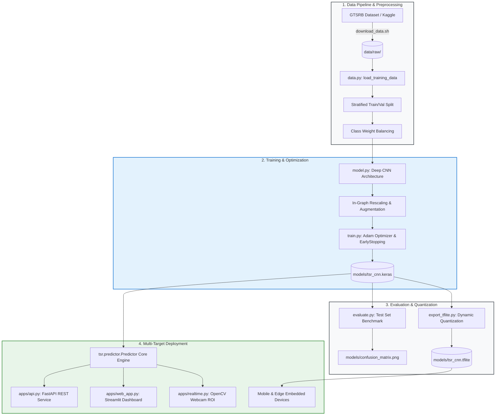
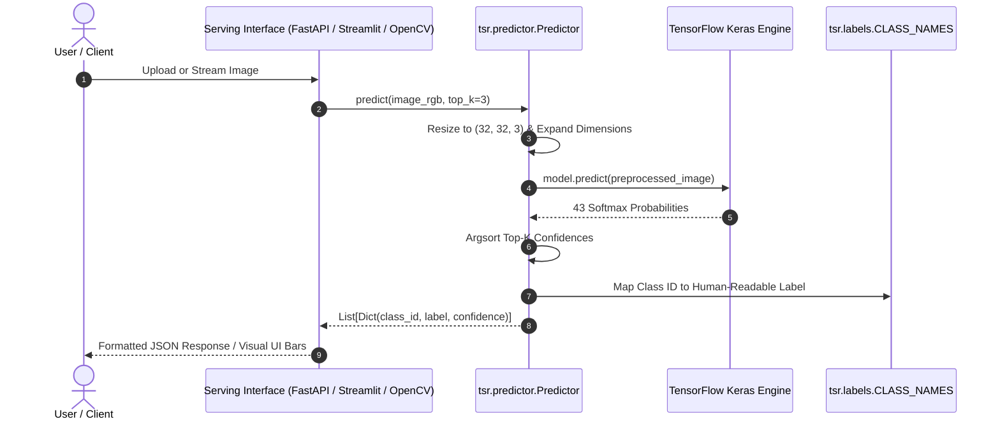
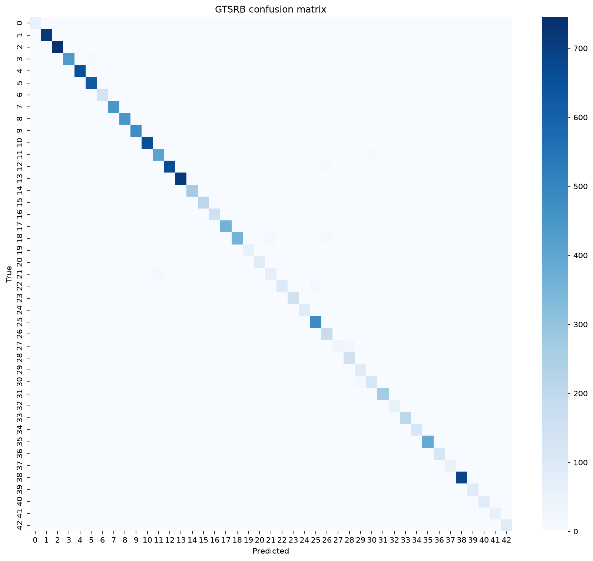

# 🚦 Traffic Sign Recognition System (GTSRB Deep Learning)

[](https://github.com/SPradhan-code/Traffic-Sign-Recognition/actions/workflows/ci.yml)
[](https://www.python.org/)
[](https://www.tensorflow.org/)
[](https://fastapi.tiangolo.com/)
[](https://streamlit.io/)
[](https://www.docker.com/)
[](https://opensource.org/licenses/MIT)

An end-to-end, production-grade Deep Learning system for classifying **43 classes of German Traffic Signs (GTSRB)** using a customized Deep Convolutional Neural Network (CNN). The project includes a robust training pipeline, automated evaluation with confusion matrix generation, a shared zero-skew inference engine, and multiple deployment interfaces: **FastAPI REST API**, **Streamlit Web UI**, **OpenCV Real-time Webcam Feed**, and an edge-quantized **TensorFlow Lite** model for mobile deployment.

---

## 📌 Table of Contents
- [System Architecture](#-system-architecture)
- [CNN Architecture & Deep Learning Details](#-cnn-architecture--deep-learning-details)
- [Inference & Serving Pipeline](#-inference--serving-pipeline)
- [Features & Highlights](#-features--highlights)
- [Evaluation & Confusion Matrix](#-evaluation--confusion-matrix)
- [GTSRB Class Taxonomy](#-gtsrb-class-taxonomy)
- [Project Directory Structure](#-project-directory-structure)
- [Getting Started](#-getting-started)
  - [1. Prerequisites & Environment Setup](#1-prerequisites--environment-setup)
  - [2. Dataset Acquisition](#2-dataset-acquisition)
  - [3. Training the Model](#3-training-the-model)
  - [4. Model Evaluation](#4-model-evaluation)
  - [5. Export to TensorFlow Lite](#5-export-to-tensorflow-lite)
- [Running the Applications](#-running-the-applications)
  - [FastAPI REST Service](#-fastapi-rest-service)
  - [Streamlit Interactive Web UI](#-streamlit-interactive-web-ui)
  - [OpenCV Real-Time Webcam Demo](#-opencv-real-time-webcam-demo)
  - [Dockerized Deployment](#-dockerized-deployment)
- [Testing & Quality Assurance](#-testing--quality-assurance)
- [Troubleshooting & Limitations](#-troubleshooting--limitations)
- [License](#-license)

---

## 📐 System Architecture

The following diagram illustrates the complete end-to-end lifecycle from raw data ingestion and model training to deployment targets:



---

## 🧠 CNN Architecture & Deep Learning Details

The classifier utilizes an optimized convolutional neural network designed specifically for traffic sign detection under varying illumination, weather, and motion-blur conditions.

```mermaid
graph TD
    Input["Input Image: 32x32x3 (RGB)"] --> Rescale["Rescaling Layer (1/255.0)"]
    
    subgraph InGraphAug ["In-Graph Augmentation (Train Time Only)"]
        Rescale --> Rot["Random Rotation (±5%)"]
        Rot --> Zoom["Random Zoom (±10%)"]
        Zoom --> Trans["Random Translation (±10% x/y)"]
    end
    
    subgraph Block1 ["Convolutional Block 1"]
        Trans --> Conv1["Conv2D (32 filters, 3x3, ReLU, Same)"]
        Conv1 --> BN1["BatchNormalization"]
        BN1 --> Conv2["Conv2D (32 filters, 3x3, ReLU, Same)"]
        Conv2 --> BN2["BatchNormalization"]
        BN2 --> Pool1["MaxPooling2D (2x2)"]
        Pool1 --> Drop1["Dropout (25%)"]
    end

    subgraph Block2 ["Convolutional Block 2"]
        Drop1 --> Conv3["Conv2D (64 filters, 3x3, ReLU, Same)"]
        Conv3 --> BN3["BatchNormalization"]
        BN3 --> Conv4["Conv2D (64 filters, 3x3, ReLU, Same)"]
        Conv4 --> BN4["BatchNormalization"]
        BN4 --> Pool2["MaxPooling2D (2x2)"]
        Pool2 --> Drop2["Dropout (25%)"]
    end

    subgraph Block3 ["Convolutional Block 3"]
        Drop2 --> Conv5["Conv2D (128 filters, 3x3, ReLU, Same)"]
        Conv5 --> BN5["BatchNormalization"]
        BN5 --> Conv6["Conv2D (128 filters, 3x3, ReLU, Same)"]
        Conv6 --> BN6["BatchNormalization"]
        BN6 --> Pool3["MaxPooling2D (2x2)"]
        Pool3 --> Drop3["Dropout (25%)"]
    end

    subgraph ClassificationHead ["Dense Classification Head"]
        Drop3 --> Flat["Flatten Layer"]
        Flat --> Dense1["Dense Layer (256 units, ReLU)"]
        Dense1 --> BN7["BatchNormalization"]
        BN7 --> Drop4["Dropout (50%)"]
        Drop4 --> DenseOut["Dense Output (43 classes, Softmax)"]
    end

    DenseOut --> Probs["Top-K Predicted Probabilities & Class IDs"]

    classDef aug fill:#fff3e0,stroke:#f57c00,stroke-width:1.5px;
    classDef conv fill:#ede7f6,stroke:#512da8,stroke-width:1.5px;
    classDef dense fill:#e0f2f1,stroke:#00796b,stroke-width:1.5px;
    class InGraphAug aug;
    class Block1,Block2,Block3 conv;
    class ClassificationHead dense;
```



### Key Design Highlights:
- **No Horizontal Flips in Augmentation**: Flipping traffic signs horizontally would change the semantic meaning (e.g., changing a "Turn Left" sign into "Turn Right").
- **Rescaling Inside the Graph**: Normalization ($[0, 255] \to [0.0, 1.0]$) is built directly into the model graph, ensuring that exported models and serving endpoints never suffer from preprocessing drift.
- **Batch Normalization & Dropout**: Stabilizes training dynamics and mitigates overfitting on smaller classes.
- **Balanced Class Weighting**: Automatically balances class penalties during loss backpropagation (`compute_class_weight`), preventing dominant classes from biasing the model.

---

## ⚡ Inference & Serving Pipeline

To guarantee consistency, all serving applications (FastAPI, Streamlit, and OpenCV) share a unified `Predictor` class:



---

## 🌟 Features & Highlights

- **🎯 High Accuracy**: Evaluated on the official German Traffic Sign Recognition Benchmark test set.
- **🛡️ Zero Serving-Training Drift**: Preprocessing and normalization are shared across all entrypoints.
- **🚀 Ultra-fast Async REST API**: Built on FastAPI, fully typed with Pydantic validation, health checks, and interactive OpenAPI Swagger documentation.
- **🎨 Interactive Web Dashboard**: Built with Streamlit for drag-and-drop image prediction and visual confidence bars.
- **📹 Real-Time Live Webcam Detection**: Live video feed with region-of-interest (ROI) bounding box and configurable confidence thresholding.
- **📱 Mobile Ready (TensorFlow Lite)**: Dynamic-range quantized `.tflite` model weighing only **~850 KB**, ready for iOS, Android, and Raspberry Pi edge devices.
- **🐳 Containerized Deployment**: Production Dockerfile included with non-root runtime and automated healthcheck.
- **🧪 Test Suite Without Dataset**: Unit tests verify API endpoints, predictor logic, and model compilation using lightweight mock graphs without downloading gigabytes of training data.

---

## 📊 Evaluation & Confusion Matrix

The model evaluation script (`tsr.evaluate`) runs predictions over the official GTSRB test dataset, computes the classification report across all 43 classes, and saves a high-resolution confusion matrix:

<div align="center">
  
  <p><em>Figure: Confusion Matrix across all 43 German Traffic Sign classes.</em></p>
</div>

---

## 🏷️ GTSRB Class Taxonomy

The 43 traffic sign classes categorized by sign type:

| Category | Class IDs | Sample Traffic Signs |
| :--- | :--- | :--- |
| **Speed Limits** | 0, 1, 2, 3, 4, 5, 7, 8 | 20, 30, 50, 60, 70, 80, 100, 120 km/h |
| **Prohibitory** | 9, 10, 15, 16, 17 | No passing, No vehicles, No entry |
| **Danger / Warnings** | 18, 19, 20, 21, 22, 23, 24, 25, 26, 27, 28, 29, 30, 31 | Curves, Bumpy road, Slippery, Road work, Signals, Pedestrians |
| **Mandatory** | 33, 34, 35, 36, 37, 38, 39, 40 | Turn right/left, Ahead only, Roundabout |
| **Priority / Rights** | 11, 12, 13, 14 | Right-of-way, Priority road, Yield, Stop |
| **End of Restrictions** | 6, 32, 41, 42 | End of speed limit, End of no passing |

---

## 📂 Project Directory Structure

```plaintext
Traffic-Sign-Recognition/
├── .github/
│   └── workflows/
│       └── ci.yml               # GitHub Actions CI workflow (linting + tests)
├── apps/
│   ├── __init__.py
│   ├── api.py                   # FastAPI REST application
│   ├── realtime.py              # OpenCV real-time webcam inference
│   └── web_app.py               # Streamlit interactive dashboard
├── configs/
│   └── config.yaml              # Hyperparameters and path configuration
├── data/
│   └── raw/
│       └── .gitkeep             # Destination folder for GTSRB dataset
├── models/
│   ├── .gitkeep
│   ├── confusion_matrix.png     # Evaluation confusion matrix plot
│   ├── tsr_cnn.keras            # Trained CNN model weights (~9.5 MB)
│   └── tsr_cnn.tflite           # Quantized mobile TFLite model (~850 KB)
├── notebooks/
│   └── train_on_colab.ipynb     # Google Colab notebook for GPU training
├── scripts/
│   └── download_data.sh         # Dataset download automation via Kaggle API
├── src/
│   └── tsr/
│       ├── __init__.py
│       ├── config.py            # YAML configuration loader
│       ├── data.py              # Image loading and train/test split utilities
│       ├── evaluate.py          # Benchmark evaluation & confusion matrix
│       ├── export_tflite.py     # TFLite conversion & quantization
│       ├── labels.py            # 43 human-readable class names
│       ├── model.py             # Keras CNN model architecture
│       ├── predictor.py         # Shared inference engine
│       └── train.py             # Model training entry point
├── tests/
│   ├── conftest.py              # Fixtures with lightweight dummy model
│   ├── test_api.py              # API endpoint validation
│   ├── test_model.py            # CNN build and shape verification
│   └── test_predictor.py        # Prediction logic unit tests
├── .dockerignore
├── .flake8                      # Flake8 style guide configuration
├── .gitignore                   # Excludes raw data images & virtualenvs
├── Dockerfile                   # Production container definition
├── Makefile                     # Shortcut task runner commands
├── pyproject.toml               # Package build metadata
├── pytest.ini                   # Pytest test configuration
├── README.md                    # Project documentation
├── requirements.txt             # Runtime dependencies
└── requirements-dev.txt         # Development & test dependencies
```

---

## 🚀 Getting Started

### 1. Prerequisites & Environment Setup

- Python 3.9, 3.10, or 3.11 installed
- Git installed

```bash
# 1. Clone the repository
git clone https://github.com/SPradhan-code/Traffic-Sign-Recognition.git
cd Traffic-Sign-Recognition

# 2. Create and activate a virtual environment
python -m venv .venv

# On Linux/macOS:
source .venv/bin/activate
# On Windows (PowerShell):
.venv\Scripts\Activate.ps1

# 3. Install dependencies in editable mode
pip install -r requirements-dev.txt
pip install -e .
```

### 2. Dataset Acquisition

The model is trained on the [German Traffic Sign Recognition Benchmark (GTSRB)](https://www.kaggle.com/datasets/meowmeowmeowmeowmeow/gtsrb-german-traffic-sign).

#### Automated Download via Kaggle CLI:
1. Place your `kaggle.json` API token in `~/.kaggle/` (Windows: `C:\Users\<user>\.kaggle\kaggle.json`).
2. Run the download script:
   ```bash
   bash scripts/download_data.sh
   # Or using Makefile:
   make data
   ```

#### Manual Download:
Extract the GTSRB dataset into `data/raw/` so that the following structure exists:
```
data/raw/
├── Train/
│   ├── 0/ ... 42/
├── Test/
└── Test.csv
```

### 3. Training the Model

Train the model locally:
```bash
python -m tsr.train
# Or using the Makefile:
make train
```

> **Tip**: To train on a free GPU in Google Colab, upload the repository zip along with your `kaggle.json` into `notebooks/train_on_colab.ipynb`, execute all cells, and download the trained `tsr_cnn.keras` into `models/`.

### 4. Model Evaluation

Compute test set accuracy, generate the per-class classification report, and output the confusion matrix:
```bash
python -m tsr.evaluate
# Or using the Makefile:
make evaluate
```

### 5. Export to TensorFlow Lite

Convert the trained Keras model into an optimized `.tflite` model with dynamic-range quantization:
```bash
python -m tsr.export_tflite
# Or using the Makefile:
make tflite
```

---

## 💻 Running the Applications

### 🌐 FastAPI REST Service

Start the high-throughput ASGI server:
```bash
uvicorn apps.api:app --host 0.0.0.0 --port 8000 --reload
# Or using the Makefile:
make api
```

- **Interactive Swagger Docs**: [http://localhost:8000/docs](http://localhost:8000/docs)
- **Health Check Endpoint**: [http://localhost:8000/health](http://localhost:8000/health)

#### Test Prediction via `curl`:
```bash
curl -X POST "http://localhost:8000/predict?top_k=3" \
     -H "accept: application/json" \
     -H "Content-Type: multipart/form-data" \
     -F "file=@path/to/sign_image.png"
```

#### Sample Response:
```json
{
  "predictions": [
    {
      "class_id": 14,
      "label": "Stop",
      "confidence": 0.9984
    },
    {
      "class_id": 17,
      "label": "No entry",
      "confidence": 0.0012
    },
    {
      "class_id": 33,
      "label": "Turn right ahead",
      "confidence": 0.0002
    }
  ]
}
```

---

### 🎨 Streamlit Interactive Web UI

Launch the browser-based dashboard:
```bash
streamlit run apps/web_app.py
# Or using the Makefile:
make web
```
Open [http://localhost:8501](http://localhost:8501) in your browser, drag and drop any traffic sign photo, and inspect the ranked class confidences.

---

### 📹 OpenCV Real-Time Webcam Demo

Test the live classifier using your computer's webcam:
```bash
python apps/realtime.py --camera 0 --threshold 0.8
# Or using the Makefile:
make cam
```
- Hold a traffic sign inside the green Region of Interest (ROI) bounding box.
- Press **`q`** to exit the video stream.

---

### 🐳 Dockerized Deployment

Build and run the containerized FastAPI service:
```bash
# Build the Docker image
docker build -t traffic-sign-recognition .

# Run the container
docker run -d -p 8000:8000 --name tsr-app traffic-sign-recognition

# Check service health
curl http://localhost:8000/health
```

---

## 🧪 Testing & Quality Assurance

The test suite validates model construction, predictor output schemas, and FastAPI status codes using mock fixtures (without requiring dataset downloads):

```bash
# Run tests
pytest -q

# Format code
black --check src apps tests

# Linting
flake8 src apps tests --max-line-length 100
```

---

## ⚠️ Troubleshooting & Limitations

- **ModuleNotFoundError: No module named 'tsr'**: Run `pip install -e .` from the repository root directory.
- **Webcam Fails to Open**: Check permissions or specify an alternate camera index with `--camera 1`.
- **Pre-cropped Image Assumption**: GTSRB contains tightly cropped traffic signs. For open-world driving scenes with wide camera perspectives, chain an object detector (such as YOLO or SSD) in front of this classifier to first localize signs.

---

## 📄 License

This project is licensed under the [MIT License](https://opensource.org/licenses/MIT).
